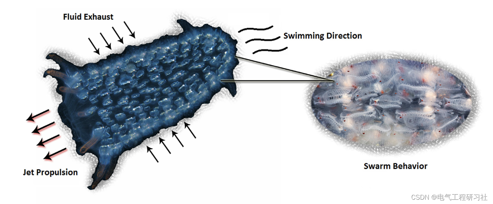
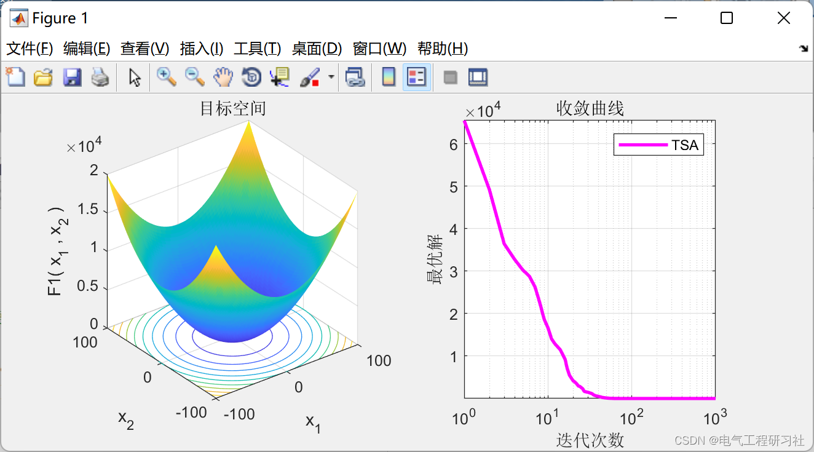
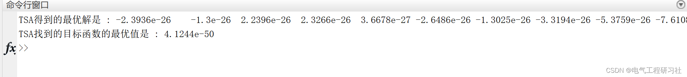
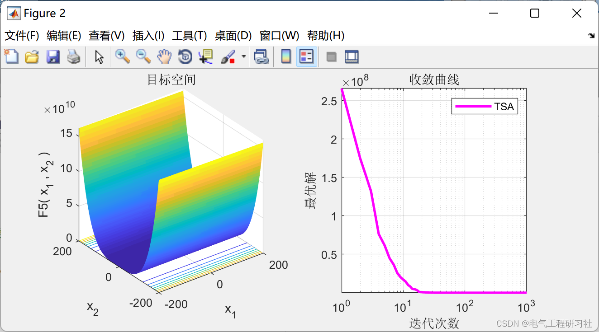
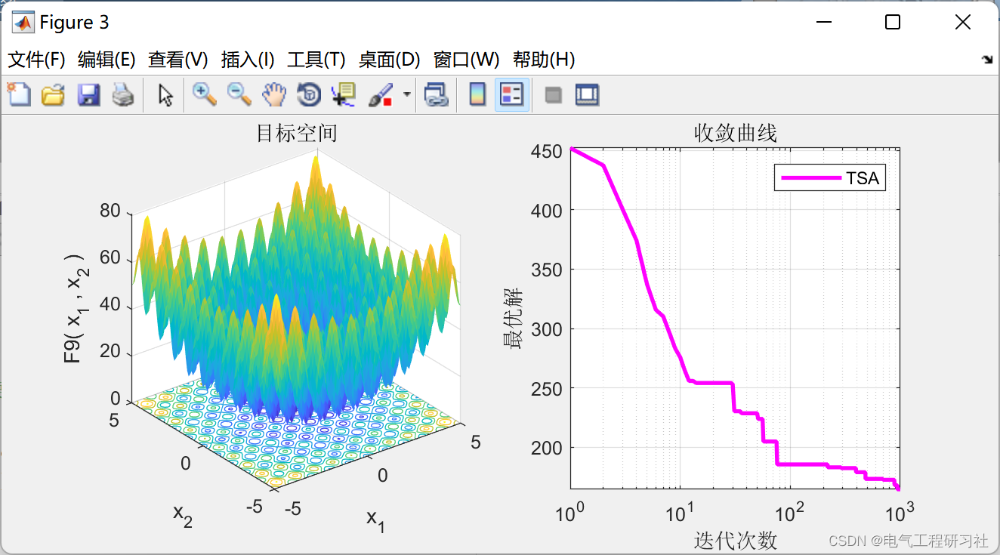
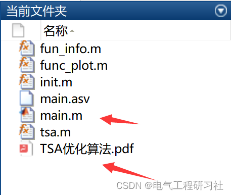

# TSA Optimization Algorithm - A New Bio-Inspired Optimization Algorithm (Matlab Code Implementation)

1. Overview of the paper introduces a biomimetic heuristic optimization algorithm called Tunicate Swarm (TSA). The proposed algorithm mimics the jet propulsion and cluster behaviors of invertebrates during navigation and foraging processes. Sensitivity, convergence, and scalability analyses, along with ANOVA tests, were used to evaluate the performance of TSA on 74 benchmark problems. The efficacy of the algorithm was further compared with several widely acclaimed heuristic methods based on generated optimal solutions. Additionally, the proposed algorithm was executed on six constrained and one unconstrained engineering design problem to further validate its robustness. Simulation results indicate that TSA generates better optimal solutions compared to other competitive algorithms, and is capable of solving real-world case studies with unknown search spaces.
Editor
2 Mathematical Model
Tunicate has the ability to locate food sources in the ocean. However, it is unaware of the food sources within the given search space. This paper adopts two behaviors of invertebrates to find food sources, namely optimal. These behaviors are jet propulsion and group intelligence. To mathematically model the jet propulsion behavior, invertebrates should satisfy three conditions: avoiding conflicts among search agents, moving towards the location of the best search agent, and maintaining close proximity to the best search agent. However, the group behavior updates the positions of other search agents to obtain the best optimal solution. The mathematical modeling of these behaviors is described in previous sections:
Detailed mathematical models can be found in Section 4.
3 Run Results
Editor
Editor
Editor
clear all; clc;
\n\n\n\nfunction [lowerbound,upperbound,dimension,fitness] = fun_info(F)\n\n\nswitch F\n    case 'F1'\n        fitness = @F1;\n        lowerbound=-100;\n        upperbound=100;\n        dimension=30;\n        \n    case 'F2'\n        fitness = @F2;\n        lowerbound=-10;\n        upperbound=10;\n        dimension=30;\n        \n    case 'F3'\n        fitness = @F3;\n        lowerbound=-100;\n        upperbound=100;\n        dimension=30;\n        \n    case 'F4'\n        fitness = @F4;\n        lowerbound=-100;\n        upperbound=100;\n        dimension=30;\n        \n    case 'F5'\n        fitness = @F5;\n        lowerbound=-30;\n        upperbound=30;\n        dimension=30;\n        \n    case 'F6'\n        fitness = @F6;\n        lowerbound=-100;\n        upperbound=100;\n        dimension=30;\n        \n    case 'F7'\n        fitness = @F7;\n        lowerbound=-1.28;\n        upperbound=1.28;\n        dimension=30;\n        \n    case 'F8'\n        fitness = @F8;\n        lowerbound=-500;\n        upperbound=500;\n        dimension=30;\n        \n    case 'F9'\n        fitness = @F9;\n        lowerbound=-5.12;\n        upperbound=5.12;\n        dimension=30;\n        \n    case 'F10'\n        fitness = @F10;\n        lowerbound=-32;\n        upperbound=32;\n        dimension=30;\n        \n    case 'F11'\n        fitness = @F11;\n        lowerbound=-600;\n        upperbound=600;\n        dimension=30;\n        \n    case 'F12'\n        fitness = @F12;\n        lowerbound=-50;\n        upperbound=50;\n        dimension=30;\n        \n    case 'F13'\n        fitness = @F13;\n        lowerbound=-50;\n        upperbound=50;\n        dimension=30;\n        \n    case 'F14'\n        fitness = @F14;\n        lowerbound=-65.536;\n        upperbound=65.536;\n        dimension=2;\n        \n    case 'F15'\n        fitness = @F15;\n        lowerbound=-5;\n        upperbound=5;\n        dimension=4;\n        \n    case 'F16'\n        fitness = @F16;\n        lowerbound=-5;\n        upperbound=5;\n        dimension=2;\n        \n    case 'F17'\n        fitness = @F17;\n        lowerbound=[-5,0];\n        upperbound=[10,15];\n        dimension=2;\n        \n    case 'F18'\n        fitness = @F18;\n        lowerbound=-2;\n        upperbound=2;\n        dimension=2;\n        \n    case 'F19'\n        fitness = @F19;\n        lowerbound=0;\n        upperbound=1;\n        dimension=3;\n        \n    case 'F20'\n        fitness = @F20;\n        lowerbound=0;\n        upperbound=1;\n        dimension=6;     \n        \n    case 'F21'\n        fitness = @F21;\n        lowerbound=0;\n        upperbound=10;\n        dimension=4;    \n        \n    case 'F22'\n        fitness = @F22;\n        lowerbound=0;\n        upperbound=10;\n        dimension=4;    \n        \n    case 'F23'\n        fitness = @F23;\n        lowerbound=0;\n        upperbound=10;\n        dimension=4;            \nend\n\nend\n\n% F1\n\nfunction R = F1(x)\nR=sum(x.^2);\nend\n\n% F2\n\nfunction R = F2(x)\nR=sum(abs(x))+prod(abs(x));\nend\n\n% F3\n\nfunction R = F3(x)\ndimension=size(x,2);\nR=0;\nfor i=1:dimension\n    R=R+sum(x(1:i))^2;\nend\nend\n\n% F4\n\nfunction R = F4(x)\nR=max(abs(x));\nend\n\n% F5\n\nfunction R = F5(x)\ndimension=size(x,2);\nR=sum(100*(x(2:dimension)-(x(1:dimension-1).^2)).^2+(x(1:dimension-1)-1).^2);\nend\n\n% F6\n\nfunction R = F6(x)\nR=sum(abs((x+.5)).^2);\nend\n\n% F7\n\nfunction R = F7(x)\ndimension=size(x,2);\nR=sum([1:dimension].*(x.^4))+rand;\nend\n\n% F8\n\nfunction R = F8(x)\nR=sum(-x.*sin(sqrt(abs(x))));\nend\n\n% F9\n\nfunction R = F9(x)\ndimension=size(x,2);\nR=sum(x.^2-10*cos(2*pi.*x))+10*dimension;\nend\n\n% F10\n\nfunction R = F10(x)\ndimension=size(x,2);\nR=-20*exp(-.2*sqrt(sum(x.^2)/dimension))-exp(sum(cos(2*pi.*x))/dimension)+20+exp(1);\nend\n\n% F11\n\nfunction R = F11(x)\ndimension=size(x,2);\nR=sum(x.^2)/4000-prod(cos(x./sqrt([1:dimension])))+1;\nend\n\n% F12\n\nfunction R = F12(x)\ndimension=size(x,2);\nR=(pi/dimension)*(10*((sin(pi*(1+(x(1)+1)/4)))^2)+sum((((x(1:dimension-1)+1)./4).^2).*...\n(1+10.*((sin(pi.*(1+(x(2:dimension)+1)./4)))).^2))+((x(dimension)+1)/4)^2)+sum(Ufun(x,10,100,4));\nend\n\n% F13\n\nfunction R = F13(x)\ndimension=size(x,2);\nR=.1*((sin(3*pi*x(1)))^2+sum((x(1:dimension-1)-1).^2.*(1+(sin(3.*pi.*x(2:dimension))).^2))+...\n((x(dimension)-1)^2)*(1+(sin(2*pi*x(dimension)))^2))+sum(Ufun(x,5,100,4));\nend\n\n% F14\n\nfunction R = F14(x)\naS=[-32 -16 0 16 32 -32 -16 0 16 32 -32 -16 0 16 32 -32 -16 0 16 32 -32 -16 0 16 32;,...\n-32 -32 -32 -32 -32 -16 -16 -16 -16 -16 0 0 0 0 0 16 16 16 16 16 32 32 32 32 32];\n\nfor j=1:25\n    bS(j)=sum((x'-aS(:,j)).^6);\nend\nR=(1/500+sum(1./([1:25]+bS))).^(-1);\nend\n\n% F15\n\nfunction R = F15(x)\naK=[.1957 .1947 .1735 .16 .0844 .0627 .0456 .0342 .0323 .0235 .0246];\nbK=[.25 .5 1 2 4 6 8 10 12 14 16];bK=1./bK;\nR=sum((aK-((x(1).*(bK.^2+x(2).*bK))./(bK.^2+x(3).*bK+x(4)))).^2);\nend\n\n% F16\n\nfunction R = F16(x)\nR=4*(x(1)^2)-2.1*(x(1)^4)+(x(1)^6)/3+x(1)*x(2)-4*(x(2)^2)+4*(x(2)^4);\nend\n\n% F17\n\nfunction R = F17(x)\nR=(x(2)-(x(1)^2)*5.1/(4*(pi^2))+5/pi*x(1)-6)^2+10*(1-1/(8*pi))*cos(x(1))+10;\nend\n\n% F18\n\nfunction R = F18(x)\nR=(1+(x(1)+x(2)+1)^2*(19-14*x(1)+3*(x(1)^2)-14*x(2)+6*x(1)*x(2)+3*x(2)^2))*...\n    (30+(2*x(1)-3*x(2))^2*(18-32*x(1)+12*(x(1)^2)+48*x(2)-36*x(1)*x(2)+27*(x(2)^2)));\nend\n\n% F19\n\nfunction R = F19(x)\naH=[3 10 30;.1 10 35;3 10 30;.1 10 35];cH=[1 1.2 3 3.2];\npH=[.3689 .117 .2673;.4699 .4387 .747;.1091 .8732 .5547;.03815 .5743 .8828];\nR=0;\nfor i=1:4\n    R=R-cH(i)*exp(-(sum(aH(i,:).*((x-pH(i,:)).^2))));\nend\nend\n\n% F20\n\nfunction R = F20(x)\naH=[10 3 17 3.5 1.7 8;.05 10 17 .1 8 14;3 3.5 1.7 10 17 8;17 8 .05 10 .1 14];\ncH=[1 1.2 3 3.2];\npH=[.1312 .1696 .5569 .0124 .8283 .5886;.2329 .4135 .8307 .3736 .1004 .9991;...\n.2348 .1415 .3522 .2883 .3047 .6650;.4047 .8828 .8732 .5743 .1091 .0381];\nR=0;\nfor i=1:4\n    R=R-cH(i)*exp(-(sum(aH(i,:).*((x-pH(i,:)).^2))));\nend\nend\n\n% F21\n\nfunction R = F21(x)\naSH=[4 4 4 4;1 1 1 1;8 8 8 8;6 6 6 6;3 7 3 7;2 9 2 9;5 5 3 3;8 1 8 1;6 2 6 2;7 3.6 7 3.6];\ncSH=[.1 .2 .2 .4 .4 .6 .3 .7 .5 .5];\n\nR=0;\nfor i=1:5\n    R=R-((x-aSH(i,:))*(x-aSH(i,:))'+cSH(i))^(-1);\nend\nend\n\n% F22\n\nfunction R = F22(x)\naSH=[4 4 4 4;1 1 1 1;8 8 8 8;6 6 6 6;3 7 3 7;2 9 2 9;5 5 3 3;8 1 8 1;6 2 6 2;7 3.6 7 3.6];\ncSH=[.1 .2 .2 .4 .4 .6 .3 .7 .5 .5];\n\nR=0;\nfor i=1:7\n    R=R-((x-aSH(i,:))*(x-aSH(i,:))'+cSH(i))^(-1);\nend\nend\n\n% F23\n\nfunction R = F23(x)\naSH=[4 4 4 4;1 1 1 1;8 8 8 8;6 6 6 6;3 7 3 7;2 9 2 9;5 5 3 3;8 1 8 1;6 2 6 2;7 3.6 7 3.6];\ncSH=[.1 .2 .2 .4 .4 .6 .3 .7 .5 .5];\n\nR=0;\nfor i=1:10\n    R=R-((x-aSH(i,:))*(x-aSH(i,:))'+cSH(i))^(-1);\nend\nend\n\nfunction R=Ufun(x,a,k,m)\nR=k.*((x-a).^m).*(x>a)+k.*((-x-a).^m).*(x<(-a));\nend\n  
​  

## Images

<!-- PAYMENT_BLOCK -->

## Get this dataset

- Payment link (Stripe): [Buy now](https://buy.stripe.com/3cs8yP7sY87d0vu9AB)
- Payment QR code: 

<!-- /PAYMENT_BLOCK -->
